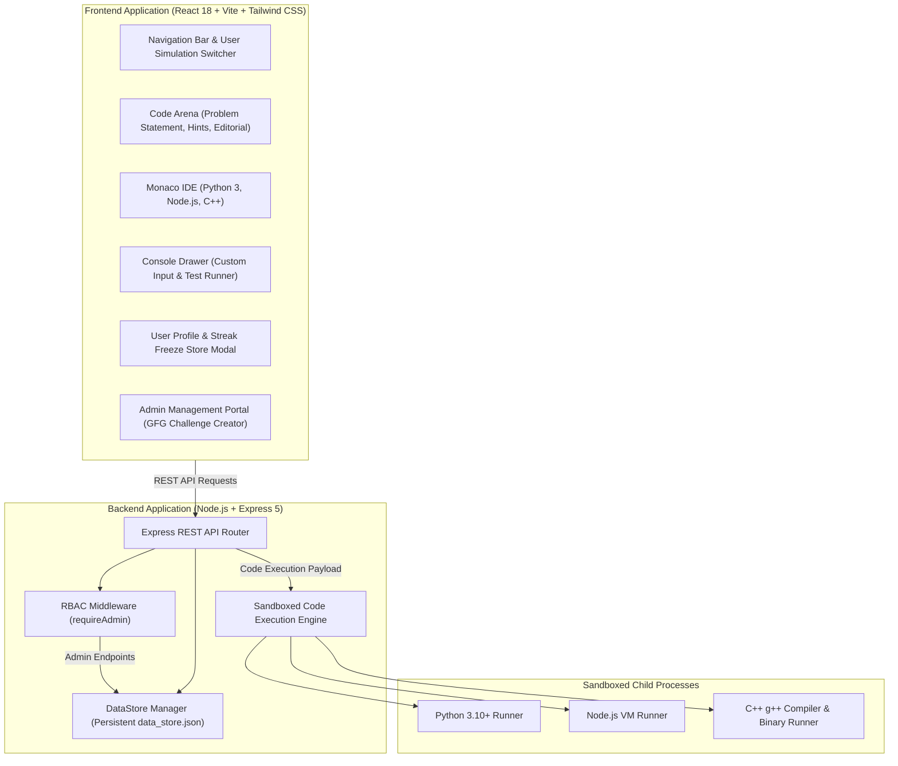

# AlgoForge Arena ⚡

> **A full-stack online judge, DSA learning platform, and GeeksforGeeks-style administration system with multi-language sandboxed code execution, interactive Monaco editor, gamified learning rewards, and role-based access control.**

[](https://nodejs.org/)
[](https://expressjs.com/)
[](https://react.dev/)
[](https://vitejs.dev/)
[](https://tailwindcss.com/)
[](https://microsoft.github.io/monaco-editor/)
[](https://opensource.org/licenses/MIT)

---

## 📑 Table of Contents

- [Overview](#-overview)
- [System Architecture](#-system-architecture)
- [Key Features](#-key-features)
  - [1. Mentee Code Arena](#1-mentee-code-arena)
  - [2. Gamification & Rewards Engine](#2-gamification--rewards-engine)
  - [3. User Profile & In-Place Editing](#3-user-profile--in-place-editing)
  - [4. Role-Based Access Control (RBAC)](#4-role-based-access-control-rbac)
  - [5. GeeksforGeeks-Style Admin Panel](#5-geeksforgeeks-style-admin-panel)
- [Technology Stack](#-technology-stack)
- [Project Directory Structure](#-project-directory-structure)
- [Getting Started](#-getting-started)
  - [Prerequisites](#prerequisites)
  - [Installation & Setup](#installation--setup)
  - [Running the Application](#running-the-application)
- [Seed User Accounts for Testing](#-seed-user-accounts-for-testing)
- [API Reference](#-api-reference)
- [Contributing & License](#-contributing--license)

---

## 🚀 Overview

**AlgoForge Arena** is an enterprise-ready coding platform designed to provide a cohesive, high-performance learning environment similar to Scaler Academy and LeetCode, coupled with a robust problem and curriculum authoring back-office modeled after GeeksforGeeks and HackerRank.

### Core Capabilities:
- **Hierarchical Path Navigation**: Direct navigation: `Modules` $\rightarrow$ `Category (Arrays, Linked Lists, DP...)` $\rightarrow$ `Problem Number & Title`.
- **Sandboxed Polyglot Judge**: Executes untrusted code inside isolated worker sub-processes supporting **Python 3**, **JavaScript (Node.js)**, and **C++ (g++ 17)**.
- **Engagement Loop**: Points, daily streak maintenance, streak freeze safety nets, and point-gated progressive hints.
- **Self-Service Profiles**: Rich mentee profiles with editable personal bios, college/company, target roles, preferred languages, and GitHub/LinkedIn handles.
- **Role-Based Security**: Students cannot view or access administrative features; backend APIs enforce `403 Forbidden` verification.

---

## 🏛 System Architecture



---

## 🌟 Key Features

### 1. Mentee Code Arena
- **Hierarchical Breadcrumbs**: Seamless dropdown switching between 13 DSA modules and their respective challenges.
- **Monaco Code Editor**: VS Code-powered editor supporting auto-completion, bracket matching, custom dark themes, language toggling, and starter code boilerplate resets.
- **Two Execution Modes**:
  - **Run Code**: Execute against sample test cases or arbitrary custom `stdin` inputs.
  - **Submit Solution**: Evaluates against public sample cases and hidden edge test cases with strict timeout limits and memory tracking.
- **Editorial & Discussion**: Complete official solutions, time/space complexity analysis, and community discussion with Mentor (TA) verified answers.

### 2. Gamification & Rewards Engine
- **First-Solve Rewards**: Awards **+100 to +150 points** on the first successful `Accepted` submission.
- **Anti-Grind Guard**: Solved status is indexed per user; duplicate solves do not inflate points.
- **Daily Streak Counter**: Practice streaks (`🔥 Xd`) increment when solving daily challenges.
- **Streak Freeze Protection**: Users can purchase **Streak Freezes** (`🧊`) for **100 points** in the rewards store to safeguard their streak against missed days.
- **Progressive Hint Unlocking**: Hints start locked (`🔒 Locked - 25 pts`); students spend 25 points to reveal progressive guidance without academic penalties.
- **Confetti & Live Toast**: Instant particle animations and floating reward banners on problem solve.

### 3. User Profile & In-Place Editing
- **View Mode**:
  - Avatar, full name, email, member since date, and active status indicator.
  - Role badge (`👑 ADMIN` with purple glow vs. `🎓 STUDENT` with cyan/blue).
  - Career goals: Target Engineering Role, College / Organization, Preferred Language.
  - Verified social links: GitHub and LinkedIn profiles.
  - Performance statistics: Problems solved, total submissions, acceptance rate %, and module accessibility.
- **Edit Mode (`✏️ Edit Profile`)**:
  - Live form allowing mentees to update Name, Bio, College, Target Role, Preferred Language, and GitHub/LinkedIn handles.
  - Instant persistence via `PUT /api/user/profile` and immediate reactive UI sync.

### 4. Role-Based Access Control (RBAC)
- **Student Mentee Role**:
  - Completely restricted from administrative controls.
  - Admin Panel button is hidden from the top navigation.
  - Protected backend routes return `HTTP 403 Forbidden` (`"Access Denied: Student accounts do not have permission to access the Administrator Console."`).
- **Superadministrator Role**:
  - Full access to all curriculum tracks, problem management, module provisioning, and mentee submission telemetry.
  - Special **Administrator Privileges & Master Info** section in the profile modal.
- **Simulation Switcher**: Instant one-click switcher in the navbar to test the platform as different users and verify role boundaries.

### 5. GeeksforGeeks-Style Admin Panel
- **Challenge Authoring Wizard**:
  - **Step 1 - Basic Metadata**: Problem Title, ID, Module / Category, Difficulty (`Easy`, `Medium`, `Hard`), Score, and Time Limit.
  - **Step 2 - Problem Statement**: Rich markdown description, constraints, and standard I/O format.
  - **Step 3 - Test Case Suite**: Interactive creator for public sample cases and secret hidden evaluation cases.
  - **Step 4 - Starter Code & Editorial**: Custom boilerplate templates (Python, JavaScript, C++), hints, and official editorial explanations.
- **Curriculum & Track Provisioning**:
  - Add new DSA modules (e.g. *Tries*, *Dynamic Programming*, *Graphs*).
  - One-click problem reassignment between modules.
- **User Governance & Access Allocation**:
  - Create student/admin accounts.
  - Allocate unrestricted access (`all`) or restrict access to specific modules (e.g. beginner cohorts only see Arrays & Strings).
- **Platform Analytics & Telemetry**:
  - Global KPI cards: Total users, active mentees, total challenges, total submissions, global acceptance rate.
  - Module utilization statistics: Attempts, accepted solutions, mentee reach %, and completion rates.
  - Real-time submission audit log with pass percentages and memory profiles.

---

## 🛠 Technology Stack

| Layer | Technologies |
| :--- | :--- |
| **Frontend** | React 18, Vite 5, Tailwind CSS, Monaco Editor (`@monaco-editor/react`), Lucide Icons, Canvas Confetti |
| **Backend** | Node.js 18+, Express.js 5, CORS |
| **Storage** | File-backed JSON store with transactional reads/writes (`data_store.json`), seed modules and problems |
| **Code Judge** | Node.js `child_process` sandboxed spawn executor (Python 3, Node.js 18+, g++ 17) |

---

## 📁 Project Directory Structure

```
coding_server/
├── package.json              # Root project dependencies & runner scripts
├── README.md                 # Complete platform documentation
├── .gitignore                # Git ignore patterns for dependencies & temp files
├── server/
│   ├── server.js             # Express API server, routes, and RBAC middleware
│   ├── store.js              # Data store, user management, and gamification methods
│   ├── executor.js           # Multi-language sandboxed code judge runner
│   ├── problems.js           # Default seed modules and DSA problem library
│   └── data_store.json       # Persistent data storage for users, problems, and submissions
└── frontend/
    ├── package.json          # Frontend dependencies (React, Vite, Monaco)
    ├── vite.config.js        # Vite build & development proxy configuration
    ├── index.html            # Application entry HTML
    └── src/
        ├── App.jsx           # Main workspace split-pane layout & state hub
        ├── main.jsx          # React DOM entrypoint
        ├── index.css         # Tailwind directives & dark theme styles
        └── components/
            ├── Navbar.jsx              # Navigation header, breadcrumbs, points & streak HUD
            ├── ProblemPane.jsx         # Problem statement, testcase tabs, hints & editorial
            ├── EditorPane.jsx          # Monaco code editor with language & reset controls
            ├── ConsoleDrawer.jsx       # Expandable bottom drawer for test runs & submission logs
            ├── DoubtModal.jsx          # Scaler-style 1-on-1 TA doubt assistance modal
            ├── SubmissionModal.jsx     # Past submission code inspector modal
            ├── UserProfileModal.jsx    # Profile details, gamification HUD, & edit form
            └── admin/
                ├── AdminPortal.jsx     # Master admin console navigation container
                ├── ProblemCreator.jsx  # 4-Step GeeksforGeeks challenge authoring wizard
                ├── ProblemsTab.jsx     # Filterable problem table & quick module reassigner
                ├── ModulesTab.jsx      # Module creation & curriculum reorganizer
                ├── UsersTab.jsx        # User cohort governance & granular module permissions
                └── OverviewTab.jsx     # Platform telemetry, KPIs & module utilization charts
```

---

## 🏁 Getting Started

### Prerequisites

Ensure you have the following installed on your machine:
- **Node.js** (v18.0.0 or higher) & **npm**
- **Python 3** (`python3` in your PATH, for Python solutions)
- **g++** / GCC (optional, required if compiling C++ solutions)

### Installation & Setup

1. **Clone the Repository**:
   ```bash
   git clone https://github.com/dinesh2104/code-server.git
   cd code-server
   ```

2. **One-Command Setup**:
   Install root dependencies, frontend dependencies, and build the client bundle:
   ```bash
   npm run setup
   ```

   *(Or install manually:)*
   ```bash
   npm install
   cd frontend && npm install && npm run build && cd ..
   ```

### Running the Application

Start the production server:
```bash
npm start
```
The server will start on **`http://localhost:5000`**.

For active frontend development with Hot Module Replacement (HMR):
```bash
# Terminal 1: Backend Server
npm run server

# Terminal 2: Vite Dev Server
npm run client
```

Open **`http://localhost:5000`** in your browser.

---

## 👥 Seed User Accounts for Testing

Use the **Simulation Switcher** in the top navigation bar to test the platform as different personas:

| User ID | Name | Role | Module Access | Description |
| :--- | :--- | :--- | :--- | :--- |
| `usr_admin` | **Admin Dinesh** | `admin` | Full (`all`) | System Superadmin with unrestricted Admin Panel privileges. |
| `usr_sarah` | **Sarah Chen** | `student` | Full (`all`) | Full DSA track mentee preparing for FAANG interviews. |
| `usr_alex` | **Alex Rivera** | `student` | Restricted (5 Modules) | Enrolled in Beginner Bootcamp (Arrays, Strings, Sorting...). |
| `usr_priya` | **Priya Sharma** | `student` | Restricted (5 Modules) | Core Data Structures cohort (Trees, Stacks, Queues...). |
| `usr_vikram` | **Vikram Malhotra** | `student` | Restricted (4 Modules) | Advanced track (Graphs, Dynamic Programming, Two Pointers...). |

---

## 📡 API Reference

### Public & Mentee Endpoints
| Method | Endpoint | Description |
| :--- | :--- | :--- |
| `GET` | `/api/problems` | List accessible problems filtered by the active user's permissions |
| `GET` | `/api/problems/:id` | Get comprehensive details, starter codes, and hints for a problem |
| `POST` | `/api/run` | Execute code in a sandboxed runner against sample or custom input |
| `POST` | `/api/submit` | Validate code against all test cases; awards points & updates streak on `Accepted` |
| `GET` | `/api/user/profile` | Retrieve active user profile, gamification stats, and unlocked hints |
| `PUT` | `/api/user/profile` | Update profile information (Bio, College, Target Role, Social Handles) |
| `POST` | `/api/user/buy-freeze` | Purchase a streak freeze for 100 points |
| `POST` | `/api/user/unlock-hint` | Unlock a problem hint for 25 points |
| `GET` | `/api/users/active` | Get current active user |
| `POST` | `/api/users/active` | Switch active user (for simulation / testing) |

### Administrator Endpoints *(Protected by `requireAdmin`)*
| Method | Endpoint | Description |
| :--- | :--- | :--- |
| `GET` | `/api/admin/stats` | Platform KPIs, module utilization metrics, and recent submission logs |
| `GET` | `/api/admin/problems` | List all problems across all modules |
| `POST` | `/api/admin/problems` | Create a new DSA challenge with sample & hidden test cases |
| `PUT` | `/api/admin/problems/:id` | Update an existing problem or reassign its module |
| `DELETE` | `/api/admin/problems/:id` | Delete a problem |
| `GET` | `/api/admin/modules` | List all curriculum modules |
| `POST` | `/api/admin/modules` | Create a new module category |
| `PUT` | `/api/admin/modules/:id` | Rename or update a module |
| `DELETE` | `/api/admin/modules/:id` | Delete an empty module |
| `GET` | `/api/admin/users` | List all users and their performance analytics |
| `POST` | `/api/admin/users` | Create a new user with granular module permissions |
| `PUT` | `/api/admin/users/:id` | Update user details, role (`student`/`admin`), or module access |
| `DELETE` | `/api/admin/users/:id` | Delete a user account |

---

## 📄 Contributing & License

Contributions, issues, and feature requests are welcome!

This project is licensed under the **MIT License**.
